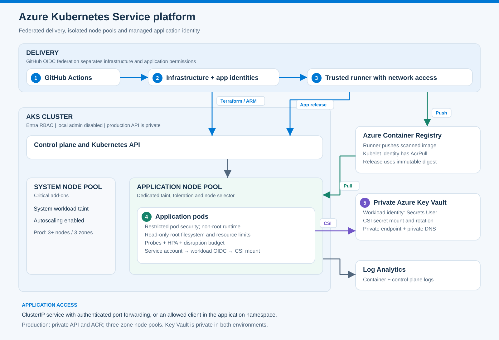
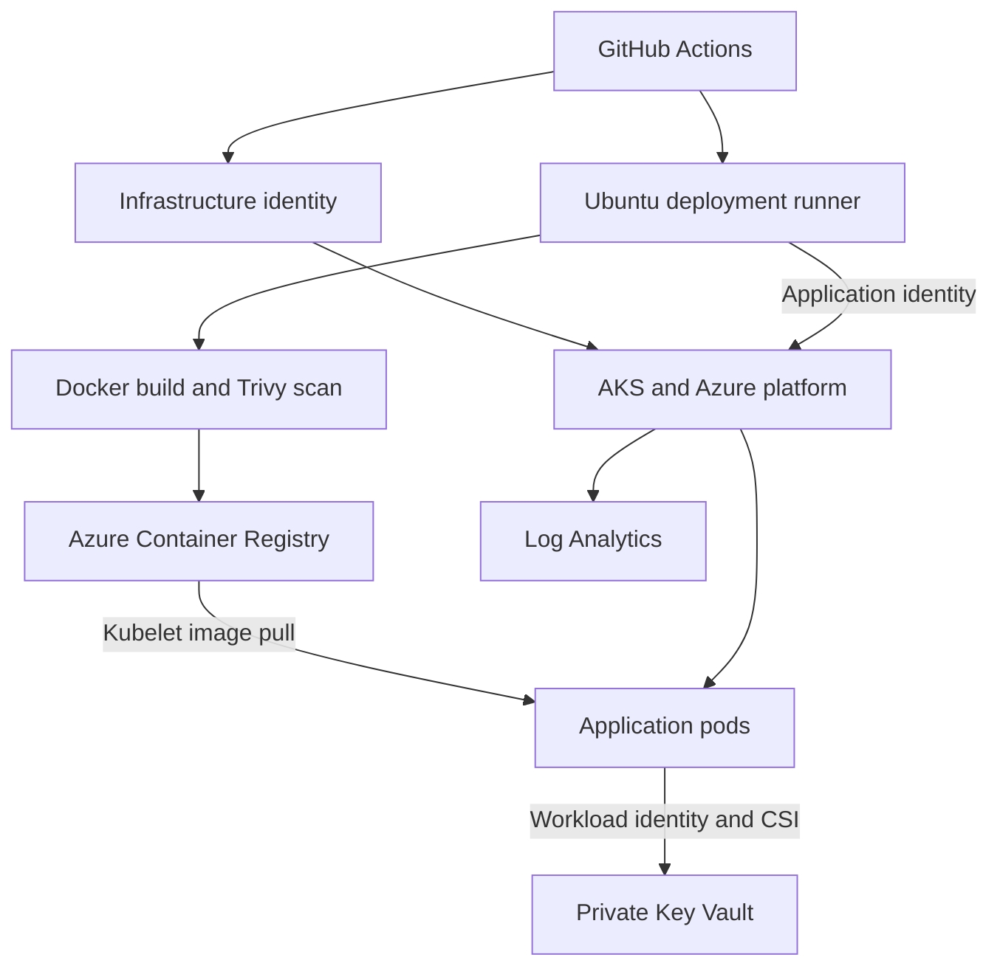
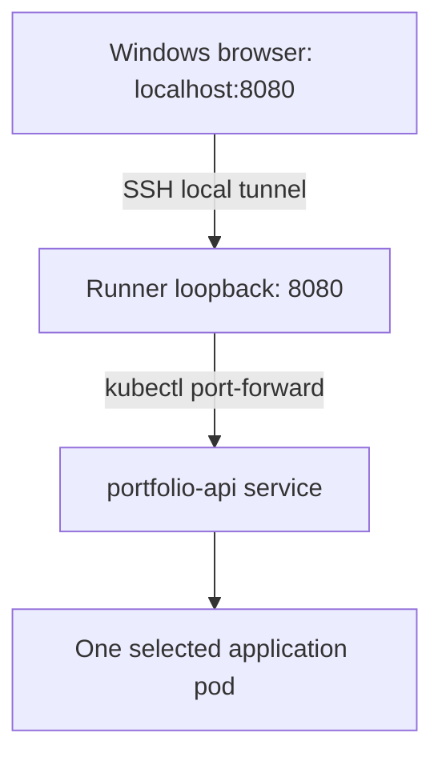

# Azure AKS Platform: From Terraform to a Running Container

[](https://github.com/dotman01k/azure-aks-platform/actions/workflows/aks-validate.yml)

**Author: Dotun Agbeluyi**

This project provisions an Azure Kubernetes Service platform with Terraform, builds a Python API into a Docker image, scans and publishes that image to Azure Container Registry, and deploys it through GitHub Actions. The running application retrieves a demonstration secret from a private Key Vault using AKS workload identity.

The development deployment was completed and tested on **23 October 2026, America/Chicago**. Both application pods were running with zero restarts, the readiness endpoint returned `ready`, and the API reported `secret_mounted: true`. The application was also opened in a Windows browser through an SSH tunnel and Kubernetes port forwarding.

The deployment required more than a successful Terraform plan. This README records the environment that actually ran, the recovery work after an earlier lab teardown, the authentication and networking problems encountered, and the evidence used to confirm the result.

## Contents

1. [Completed deployment and evidence](#completed-deployment-and-evidence)
2. [Architecture](#architecture)
3. [What manages what](#what-manages-what)
4. [Repository layout](#repository-layout)
5. [Setup and deployment sequence](#setup-and-deployment-sequence)
6. [Accessing the application](#accessing-the-application)
7. [Blockers and fixes](#blockers-and-fixes)
8. [Lessons from the deployment](#lessons-from-the-deployment)
9. [Identity, security and availability](#identity-security-and-availability)
10. [Operations and validation](#operations-and-validation)
11. [Costs, pause and cleanup](#costs-pause-and-cleanup)
12. [Limitations and follow-up work](#limitations-and-follow-up-work)

## Completed deployment and evidence

### Environment used in the lab

These are observations from the completed deployment, not permanent capacity or version guarantees.

| Component | Deployed or observed configuration |
| :--- | :--- |
| Azure region | East US |
| Resource group | `rg-aks-dev` |
| AKS cluster | `dotunaks-dev-aks` |
| Kubernetes version reported by Azure | `1.36.4` |
| System pool | 2 nodes, `Standard_D4s_v3`, Succeeded |
| Application pool | 1 node, `Standard_D4s_v3`, Succeeded |
| Registry | `dotunaksdev9d647196acr` |
| Key Vault | `dotunaks-dev-9d647196` |
| Deployment runner | Ubuntu 22.04 VM, `Standard_D2s_v3`, in the runner subnet |
| Runner registration | Linux x64, custom label `aks`, systemd service under `azureuser` |
| Application | `portfolio-api` in namespace `portfolio` |
| Application service | ClusterIP on port 80 |
| HPA | Minimum 2 pods, maximum 6, CPU target 65 percent |
| Observed replicas | 2 ready and available, zero restarts |
| PDB | Maximum 1 unavailable; 1 disruption allowed at verification |

The example tfvars in the repository are starting points. In particular, the original dev example used smaller DSv5 nodes; the actual lab used DSv3 nodes after checking available regional quota and SKU restrictions. Verify capacity again before another deployment.

### Successful workflow runs

| Stage | Evidence |
| :--- | :--- |
| Source validation | [AKS Validate](https://github.com/dotman01k/azure-aks-platform/actions/runs/40039121769) |
| Infrastructure apply and diagnostic setting import | [AKS Infrastructure](https://github.com/dotman01k/azure-aks-platform/actions/runs/40039481946) |
| Namespace, policies and Key Vault integration | [AKS Initialize Platform](https://github.com/dotman01k/azure-aks-platform/actions/runs/40049497847) |
| Docker build, vulnerability scan, ACR push and healthy rollout | [AKS Release Application](https://github.com/dotman01k/azure-aks-platform/actions/runs/40050313825) |

These runs used implementation commit [4678ebd](https://github.com/dotman01k/azure-aks-platform/commit/4678ebdba545316eb9eeefd813d1e2f8355d4838). The infrastructure recovery apply reported:

```text
Apply complete! Resources: 1 imported, 0 added, 0 changed, 0 destroyed.
```

That was the final state reconciliation step after an earlier apply had provisioned infrastructure. It does not mean the whole platform was created by an import.

The following runtime output was captured during operator verification:

```text
deployment.apps/portfolio-api   READY 2/2   UP-TO-DATE 2   AVAILABLE 2

Both portfolio-api pods:
READY 1/1   STATUS Running   RESTARTS 0

HPA:
cpu: 1%/65%   MINPODS 2   MAXPODS 6   REPLICAS 2

PDB:
MAX UNAVAILABLE 1   ALLOWED DISRUPTIONS 1
```

The root endpoint returned:

```json
{"service": "portfolio-api", "version": "local", "environment": "dev", "secret_mounted": true}
```

The readiness endpoint returned:

```text
ready
```

The `version: local` field is the application's reported metadata; it was not used to establish which image ran. The release workflow resolves the pushed ACR image digest and deploys that immutable digest. Workload identity and the mounted secret were exercised; secret rotation, load scaling and node failure recovery were not separately tested in this session.

## Architecture



Terraform provisions the Azure platform. A connected Ubuntu runner provides the Docker build environment and network access to private services. GitHub Actions uses separate infrastructure and application identities. AKS pulls the published image and runs it on the application pool.



The dev cluster uses a public API with explicit authorized IP ranges. Its NAT egress address is added automatically by Terraform. Key Vault uses a private endpoint. Dev ACR uses a public endpoint with Azure RBAC and its admin account disabled.

The production profile defines a private AKS API, private Premium ACR connectivity and larger pool minimums. That profile was not the environment exercised in this deployment.

The runner's public IP is for restricted SSH administration. Its outbound traffic uses the subnet's NAT Gateway. These are different addresses with different purposes.

## What manages what

| Layer | Owner |
| :--- | :--- |
| State account, platform RG and CI identities | Operator bootstrap through `scripts/bootstrap.sh` |
| AKS, pools, network, NAT, ACR, Key Vault, workload identity, RBAC and monitoring | Terraform in `infra` |
| Runner subnet | Terraform network module |
| Ubuntu runner VM, NIC, OS disk, public IP and SSH NSG | Created separately with Azure CLI during this lab |
| Docker and runner software installation | Installed on the Ubuntu VM during setup |
| Namespace, policies, service account and SecretProviderClass | Platform initialization workflow |
| Application image and Kubernetes application release | Release workflow |
| Windows browser access | Temporary SSH tunnel plus Kubernetes port forwarding |

The runner VM is **not in the Terraform state**. Terraform destroy will not remove that VM or its attached resources. This ownership boundary matters for reproducibility and cleanup.

## Repository layout

| Path | Purpose |
| :--- | :--- |
| [infra/main.tf](infra/main.tf) | Cluster, node pools, control plane identity and NAT API allowlist integration |
| [infra/modules/network](infra/modules/network) | VNet, subnets, NAT Gateway and outbound public IP |
| [infra/services.tf](infra/services.tf) | ACR, private Key Vault, federation and Azure roles |
| [infra/observability.tf](infra/observability.tf) | Workspace, diagnostic setting and alert configuration |
| [infra/import-diagnostics.tf](infra/import-diagnostics.tf) | Import of the existing diagnostic setting encountered in this lab |
| [infra/environments](infra/environments) | Dev and prod configuration examples |
| [app](app) | Python API and Dockerfile |
| [k8s/platform](k8s/platform) | Namespace, policies, service account and CSI configuration |
| [k8s/app](k8s/app) | Application manifests and Kustomize overlays |
| [scripts](scripts) | Bootstrap, authentication, platform initialization and deployment helpers |
| [tests](tests) | API tests and rendered manifest checks |
| [.github/workflows](.github/workflows) | Validation and manual deployment workflows |
| [docs](docs) | Detailed setup, design and operational references |

## Setup and deployment sequence

### 1. Prepare the source machine and Azure inputs

The source machine used Windows, VS Code and Git Bash. Terraform 1.13.0, Git, Azure CLI and GitHub CLI were available there. The runner used Ubuntu, Docker Engine, Azure CLI, Python with venv support, kubectl and kubelogin.

Choose actual subscription, admin group, region, CIDRs and VM sizes. Keep upgrade surge and autoscaling headroom in the quota calculation. Do not append `/32` to a value that already contains `/32`.

For Git Bash on Windows, disable path conversion before passing Azure resource IDs:

```bash
export MSYS_NO_PATHCONV=1
az login

export SUBSCRIPTION_ID="<subscription-id>"
export DEPLOY_ENV="dev"
export STATE_ACCOUNT="<existing-or-new-unique-account>"
export GITHUB_REPOSITORY="dotman01k/azure-aks-platform"
export LOCATION="eastus"

bash scripts/bootstrap.sh
```

Review the [bootstrap source](scripts/bootstrap.sh) and [setup guide](docs/setup.md) before execution. During the rebuild, `rg-aks-dev` was absent but `rg-aks-state` and its storage account remained. The existing backend was reused. State was not deleted to force a clean plan.

### 2. Configure identities and GitHub environments

Bootstrap reports client IDs and principal IDs. Use client IDs for workflow login and principal IDs for Terraform role assignments. Recreating identities produces new IDs; update every dependent input, including the workload client ID after Terraform apply.

| Environment | Required variables |
| :--- | :--- |
| `dev-plan` and `dev` | `AZURE_SUBSCRIPTION_ID`, `AZURE_TENANT_ID`, `INFRA_CLIENT_ID`, `STATE_RESOURCE_GROUP`, `STATE_STORAGE_ACCOUNT`, `TFVARS_JSON` |
| `dev` additionally | `AZURE_RESOURCE_GROUP`, `AKS_CLUSTER_NAME`, `KEY_VAULT_NAME`, `WORKLOAD_CLIENT_ID` |
| `dev-app` | `APP_CLIENT_ID`, `AZURE_TENANT_ID`, `AZURE_SUBSCRIPTION_ID`, `AZURE_RESOURCE_GROUP`, `AKS_CLUSTER_NAME`, `ACR_NAME` |

The workflows read `vars`, so put these values in **environment variables**, not only in Secrets. Values configured in `dev` are not inherited by `dev-app`. A release dispatched with environment `dev` targets GitHub environment `dev-app`.

Configure branch restrictions and required reviewers where available. Merely naming an environment in YAML does not create an approval gate.

**OIDC subject correction used in this deployment:** bootstrap creates a legacy repository subject. The repository's actual assertion included immutable account and repository IDs. Azure rejected it until the federated subjects matched. For this repository's observed subject template, the repair was:

```bash
AKS_REPO="dotman01k/azure-aks-platform"
AKS_SUBJECT=$(gh api "repos/$AKS_REPO" \
  --jq '"repo:\(.owner.login)@\(.owner.id)/\(.name)@\(.id)"') || exit 1

if [[ -z "$AKS_SUBJECT" ]]; then
  echo "Unable to resolve repository identity" >&2
  exit 1
fi

for ENVIRONMENT in dev-plan dev dev-app; do
  IDENTITY="aks-dev-infra-ci"
  [[ "$ENVIRONMENT" == "dev-app" ]] && IDENTITY="aks-dev-app-ci"

  az identity federated-credential update \
    --resource-group rg-aks-dev \
    --identity-name "$IDENTITY" \
    --name "github-$ENVIRONMENT" \
    --subject "$AKS_SUBJECT:environment:$ENVIRONMENT" \
    --output none || break
done
```

Use the exact assertion subject from the failed login when investigating a different repository or subject template. Do not log or publish bearer tokens. The bootstrap script has not yet been generalized to detect every GitHub subject template.

### 3. Plan, apply and reconcile existing resources

Run **AKS Infrastructure** on `main` with environment `dev` and operation `plan`. The rebuild plan showed `32 to add, 0 to change, 0 to destroy`.

For deployment, start operation `apply`. Review that run's own saved plan before approving. The workflow applies the saved plan from the same run.

An existing `control-plane-audit` diagnostic setting stopped the first rebuild apply. It was imported using [infra/import-diagnostics.tf](infra/import-diagnostics.tf), rather than deleted. The subsequent plan showed `1 to import, 0 to add, 0 to change, 0 to destroy`, and the import apply succeeded.

The import block refers to this lab's exact subscription/resource path. Review it before deploying into a different subscription. An earlier `recover-aks.tf` import for a failed cluster was removed once that cluster had been deleted; an import must point to an existing resource.

### 4. Prepare the connected runner

The runner VM was created in `dotunaks-dev-vnet`, subnet `runners`. Its SSH NSG rule allowed the operator's public IP as a single `/32`. Do not use the lab operator's address for another deployment or allow internet SSH from every address.

Docker Engine was installed from Docker's Ubuntu package repository. Both `sudo docker run --rm hello-world` and the same command without sudo succeeded after adding `azureuser` to the Docker group. This group grants administrator level control of the VM.

Azure CLI, kubectl matching the cluster version, and kubelogin were installed. The GitHub Linux x64 runner was downloaded and registered using the repository's **Settings → Actions → Runners** page, with checksum verification and the custom label `aks`.

From the registered runner directory:

```bash
sudo ./svc.sh install azureuser
sudo ./svc.sh start
sudo ./svc.sh status
```

The service was observed `active (running)` and enabled. Stop a foreground `./run.sh` process before starting the service. Do not run registration again merely because the listener is stopped. Keep registration tokens and SSH private keys out of source and workflow logs.

### 5. Initialize the platform, then release

Run **AKS Initialize Platform** on `main` with environment `dev`. It authenticates as infrastructure CI, writes the harmless `demo-message` secret and applies the namespace, network policies, service account and CSI SecretProviderClass.

Then run **AKS Release Application** on `main` with environment `dev`. The workflow:

1. Authenticates as application CI through OIDC.
2. Builds the image from `app` with Docker.
3. Scans fixable HIGH and CRITICAL findings using Trivy.
4. Pushes the image to ACR.
5. Resolves and deploys its immutable digest.
6. Applies the selected Kustomize overlay and waits for rollout health.

The release helper preserves HPA ownership of replica count. A failed rollout reports failure; it does not perform an automatic rollback.

## Accessing the application

The application is a JSON API. Docker Desktop is not needed to view it, and the runner's Docker process list is not an inventory of containers running on AKS nodes.

The service uses ClusterIP and has no public application endpoint. Browser access was demonstrated through two temporary connections:



### Terminal A: Ubuntu runner

The release job's Azure login is temporary and is cleared at job completion. An interactive SSH session must authenticate separately with an authorized human account:

```bash
az login --use-device-code --tenant "<tenant-id>"
az account set --subscription "<subscription-id>"

az aks get-credentials \
  --resource-group rg-aks-dev \
  --name dotunaks-dev-aks \
  --overwrite-existing

kubelogin convert-kubeconfig -l azurecli

kubectl -n portfolio get deployment,pods,service,hpa,pdb
kubectl -n portfolio port-forward service/portfolio-api 8080:80
```

Leave port forwarding running. It is a temporary diagnostic connection to a selected pod, not a test of external ingress, load balancing or production browser availability.

### Terminal B: Windows Git Bash

This command must run on the computer containing the SSH private key, not inside Ubuntu:

```bash
RUNNER_IP=$(az vm show \
  --resource-group rg-aks-dev \
  --name aks-dev-runner \
  --show-details \
  --query publicIps \
  -o tsv) || exit 1

if [[ -z "$RUNNER_IP" ]]; then
  echo "Runner public IP was not found" >&2
  exit 1
fi

ssh -i "$HOME/.ssh/aks-dev-runner" \
  -o ExitOnForwardFailure=yes \
  -N -L 127.0.0.1:8080:127.0.0.1:8080 \
  "azureuser@$RUNNER_IP"
```

Keep the tunnel open and visit http://localhost:8080 on Windows. Use another local port if 8080 is already occupied. For curl testing directly on the runner, open a second Ubuntu SSH session and use its loopback address instead.

| Endpoint | Purpose |
| :--- | :--- |
| `/` | API metadata and whether the secret file is mounted |
| `/healthz` | Process liveness |
| `/readyz` | Readiness based on the secret file being present |
| `/metrics` | Prometheus text with request counter |

The root and readiness responses were verified during this deployment. The other endpoints are implemented and covered by source tests; a separate manual browser response for each is not claimed here.

## Blockers and fixes

| Blocker observed | Diagnosis and resolution | Operational lesson |
| :--- | :--- | :--- |
| CIDR validation rejected an address ending in `/32/32` | Removed the duplicated suffix and used a valid explicit CIDR. | Keep IP addresses and CIDR inputs distinct. |
| AKS nodes timed out connecting to the API during provisioning | The earlier allowlist contained only the operator IP. Adding NAT egress access resolved the provisioning path; the source now derives that address automatically. | Check the actual outbound identity of nodes and runners, not just the administrator's IP. |
| Git push rejected username/token authentication | Restored working local GitHub authentication before pushing changes. | Repository authentication and Azure authentication are separate. |
| Deleted platform RG but retained remote state storage | Checked the subscription, RG and backend inventory; reused the state backend and rebuilt bootstrap identities. | A lab teardown can remove runtime resources while state and identity references survive. |
| Bootstrap returned `MissingSubscription` in Git Bash | Disabled Windows path conversion with `MSYS_NO_PATHCONV=1`. | A valid Azure ID can be corrupted by the local shell before Azure receives it. |
| Azure login returned `AADSTS700213` | Updated federated credential subjects to match the assertion containing immutable repository/account IDs. | OIDC issuer, audience and exact subject must agree. |
| Recreated identities left old client/principal/workload IDs in settings | Updated login variables, Terraform principal IDs and the workload service account input. | Successful identity creation is only the start of dependency reconciliation. |
| Existing diagnostic setting was absent from Terraform state | Added a declarative import and reviewed an import only plan. The final apply changed no Azure resources. | Reconcile ownership before considering deletion or recreation. |
| Runner registered with default labels | Added `aks` alongside the default labels. | An online runner still cannot receive a job whose labels do not match. |
| Runner reported already configured | Kept the existing registration and started its listener as a systemd service. | Configuration and service lifecycle are separate operations. |
| Release login inputs were all blank although initialization succeeded | Added the six required variables directly to `dev-app` using GitHub CLI. The next release passed. | Environment scope matters; `dev` values do not populate `dev-app`. |
| Interactive kubectl reported `Please run az login` | Signed in separately in the Ubuntu session, obtained credentials and converted kubeconfig with kubelogin. | A workflow's temporary Azure session is not a persistent operator session. |
| Windows curl could not reach the runner's localhost port | Added an SSH local tunnel and kept Kubernetes forwarding active on the runner. | Loopback belongs to the machine executing the command. |
| SSH failed with empty `RUNNER_IP` or a missing private key | Retrieved the IP in the new Windows terminal and used the key on Windows. | Shell variables do not automatically carry into another terminal, and keys remain on their originating machine. |

## Lessons from the deployment

1. **Validate each layer separately.** Terraform completion, a green release, Running pods, readiness, a mounted secret and browser access answer different questions. All were checked before calling this deployment complete.
2. **Keep recovery evidence.** The diagnostic import plan and apply confirmed state reconciliation without an Azure update or deletion. The cause of the setting's pre-existing ownership was not established, so no automatic explanation is asserted.
3. **Derive infrastructure addresses.** Hardcoding the previous NAT IP would make the next rebuild depend on an address that may no longer belong to this deployment.
4. **Treat environment configuration as part of delivery.** The same repository and runner can initialize the platform successfully while the application release fails because it reads a different GitHub environment.
5. **Document execution location with every access command.** Windows, Ubuntu and pods have different filesystems, loopback interfaces and authentication contexts.
6. **Separate configured controls from exercised behavior.** The HPA had working CPU metrics, but that is not evidence of a load scaling test. Two pods on one application node are not host redundancy.
7. **Track resources outside Terraform.** The manually created runner is a real dependency and a cleanup obligation. Its existence is not implied by the Terraform runner subnet.

## Identity, security and availability

| Identity | Scope and purpose |
| :--- | :--- |
| Infrastructure CI | Contributor and User Access Administrator on the platform RG; Blob Data Contributor on state; cluster administration for platform initialization |
| Application CI | AcrPush on the registry; AKS Cluster User; namespace scoped AKS RBAC Writer |
| Cluster control plane | Network Contributor on the platform VNet |
| Kubelet | AcrPull for image downloads |
| Application workload | Key Vault Secrets User, federated through the AKS service account |
| Human operator | Authorized Entra account and cluster admin group membership |

Application CI does not initialize the cluster. GitHub OIDC and AKS workload identity use separate issuers and trust subjects. No Azure client secret was needed for either workflow.

The manifests configure a nonroot user, read only root filesystem, restricted Pod Security, dropped capabilities, resource requests/limits, health probes, rolling updates, HPA, PDB and application pool scheduling. The namespace uses default deny network policies with explicit DNS, application ingress and HTTPS egress allowances. Outbound TCP 443 is not an FQDN allowlist.

The dev app pool contained one node. The two application replicas shared that pool, so this lab did not demonstrate survival of an application node failure. The PDB controls voluntary disruption; it does not prevent involuntary outages.

## Operations and validation

Inspect a failed rollout before changing it:

```bash
kubectl -n portfolio get events --sort-by=.lastTimestamp
kubectl -n portfolio logs deployment/portfolio-api --tail=100
kubectl -n portfolio rollout history deployment/portfolio-api
```

For an approved rollback:

```bash
kubectl -n portfolio rollout undo deployment/portfolio-api
kubectl -n portfolio rollout status deployment/portfolio-api --timeout=300s
```

A repeatable release should use a retained, known good ACR digest. Rollback commands are operational guidance; a rollback drill was not executed in this session.

For source validation from the repository directory:

```bash
terraform -chdir=infra fmt -check -recursive
terraform -chdir=infra init -backend=false -lockfile=readonly
terraform -chdir=infra validate
python -m pip install PyYAML==6.0.2
python -m unittest discover -s tests -v
kubectl kustomize k8s/app/overlays/dev > /tmp/dev.yaml
kubectl kustomize k8s/app/overlays/prod > /tmp/prod.yaml
python tests/check_manifests.py /tmp/dev.yaml /tmp/prod.yaml
for script in scripts/*.sh; do bash -n "$script"; done
```

The [AKS Validate workflow](.github/workflows/aks-validate.yml) also builds and scans the container. Source checks and actual Azure integration have separate evidence above. Earlier validation notes in [docs/validation.md](docs/validation.md) describe the original source validation baseline.

Container Insights, control plane diagnostics and the CPU alert are configured in code. Managed Prometheus/Grafana are not provisioned. See the [operations runbook](docs/operations.md) for KQL and troubleshooting guidance.

## Costs, pause and cleanup

The deployed lab has three D4s_v3 AKS nodes plus a D2s_v3 runner VM. Compute, managed disks, NAT Gateway, public IPs, private endpoints, ACR and log ingestion can all contribute to the bill. The AKS Free management tier does not make the node VMs free.

Stopping AKS does not stop the separate runner or remove disk, NAT, registry and other supporting charges. Deallocating the runner reduces its compute charges while retained disk and IP resources may still be billed. Use current Azure pricing and the actual subscription cost view rather than assuming an always free lab.

The earlier pause was followed by deletion of the platform RG to reduce costs. Rebuilding afterward required identity updates, removal of an obsolete import and reuse of the surviving backend. That recovery work is part of the project history.

For retirement, reconcile the current subscription, resource inventory and Terraform ownership first. Review the destroy plan through an approved maintenance process. Before Terraform network teardown, remove or detach the separately managed runner resources in dependency order: its NIC still uses the runner subnet and would block subnet deletion. Runner registration, VM, NIC, disk, public IP and SSH NSG require explicit cleanup. Remove only dedicated resources after checking references and retention needs.

Bootstrap identities, RGs and state storage are outside normal Terraform destroy. Preserve state until cleanup is verified. Key Vault soft delete and purge protection can affect immediate name reuse. Use [cleanup guidance](docs/operations.md#cleanup) with this ownership inventory.

## Limitations and follow-up work

This is a completed development deployment with a tested delivery and access path. It is not a production readiness claim.

The app is an API without a graphical frontend or business database. There is no public ingress, application DNS or browser facing TLS endpoint. The SSH tunnel is for lab access.

Load testing, HPA expansion, node failure recovery, secret rotation, backup/restore and disaster recovery were not separately exercised. Production topology, broader security review, alert delivery testing and availability objectives remain additional work.

Useful improvements are to codify runner provisioning, make bootstrap aware of the repository's OIDC subject template, validate required environment variables before login, publish meaningful application version metadata, and add approved scaling, rotation and rollback drills. These are follow-up items, not features claimed as complete.

## References

1. [Detailed setup](docs/setup.md)
2. [Architecture decisions](docs/architecture.md)
3. [Operations runbook](docs/operations.md)
4. [Docker Engine on Ubuntu](https://docs.docker.com/engine/install/ubuntu/)
5. [Azure CLI and Git Bash resource ID handling](https://github.com/Azure/azure-cli/blob/dev/doc/use_cli_with_git_bash.md)
6. [GitHub runner registration](https://docs.github.com/en/actions/how-tos/manage-runners/self-hosted-runners/add-runners)
7. [Azure API authorized IP ranges](https://learn.microsoft.com/azure/aks/api-server-authorized-ip-ranges)
8. [AKS workload identity](https://learn.microsoft.com/azure/aks/workload-identity-overview)
9. [Azure Key Vault CSI identity access](https://learn.microsoft.com/azure/aks/csi-secrets-store-identity-access)
10. [Pinned AzureRM cluster resource](https://registry.terraform.io/providers/hashicorp/azurerm/4.52.0/docs/resources/kubernetes_cluster)
